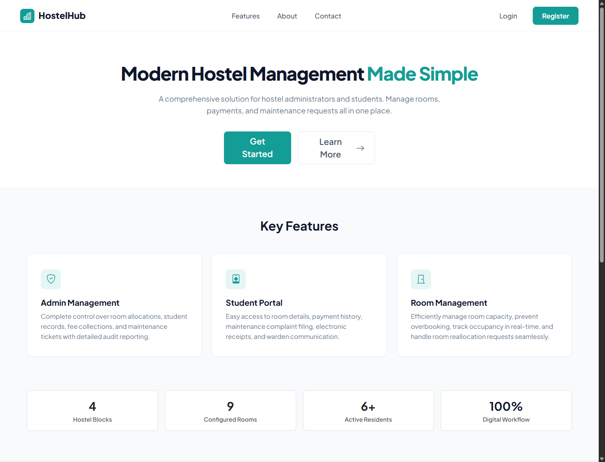
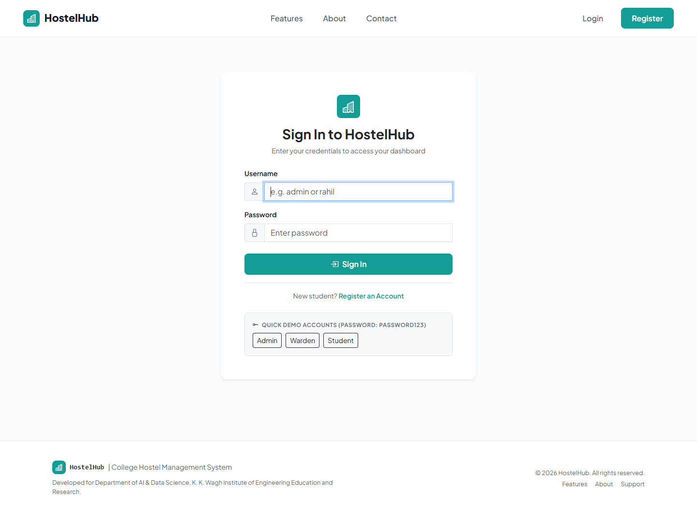
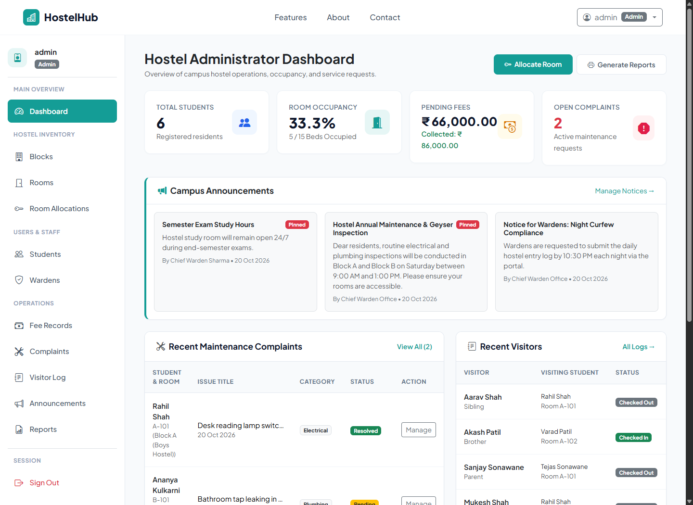
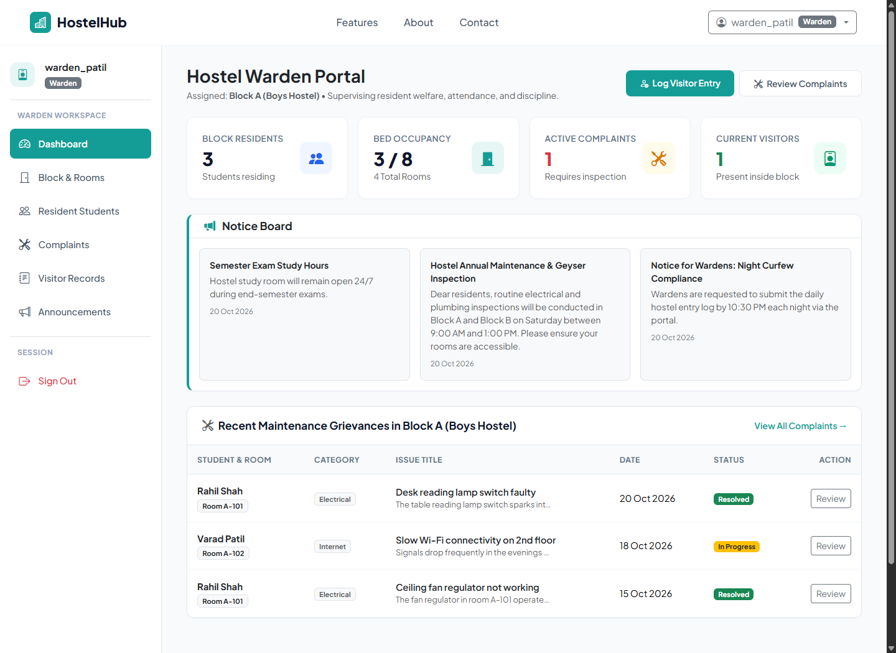
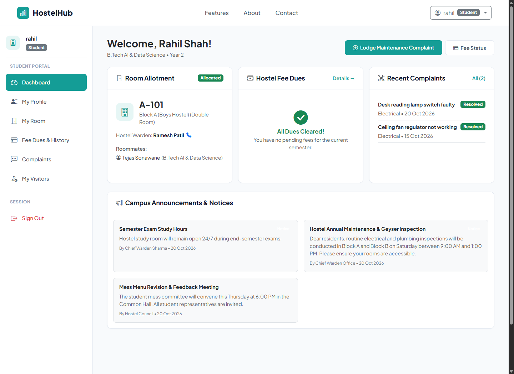
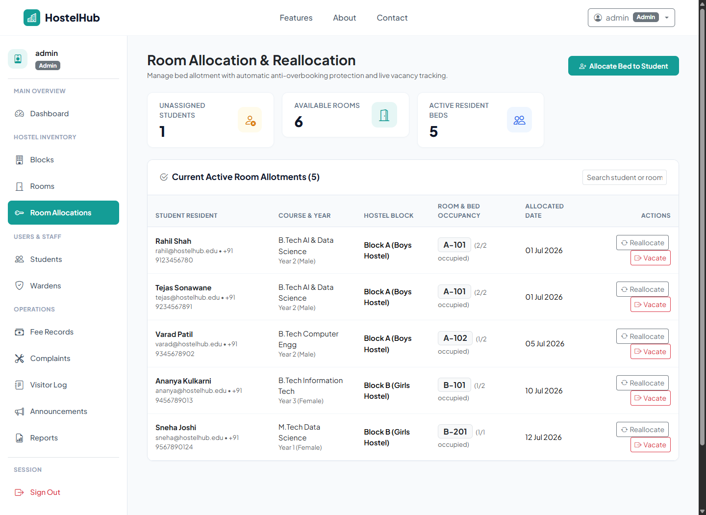
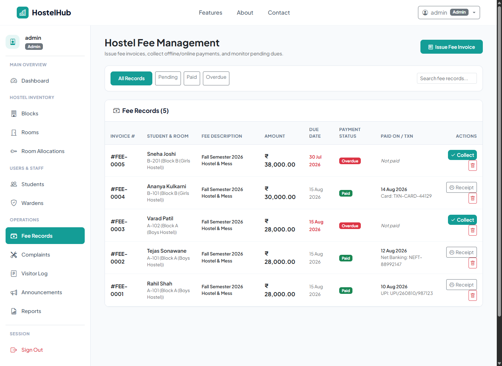
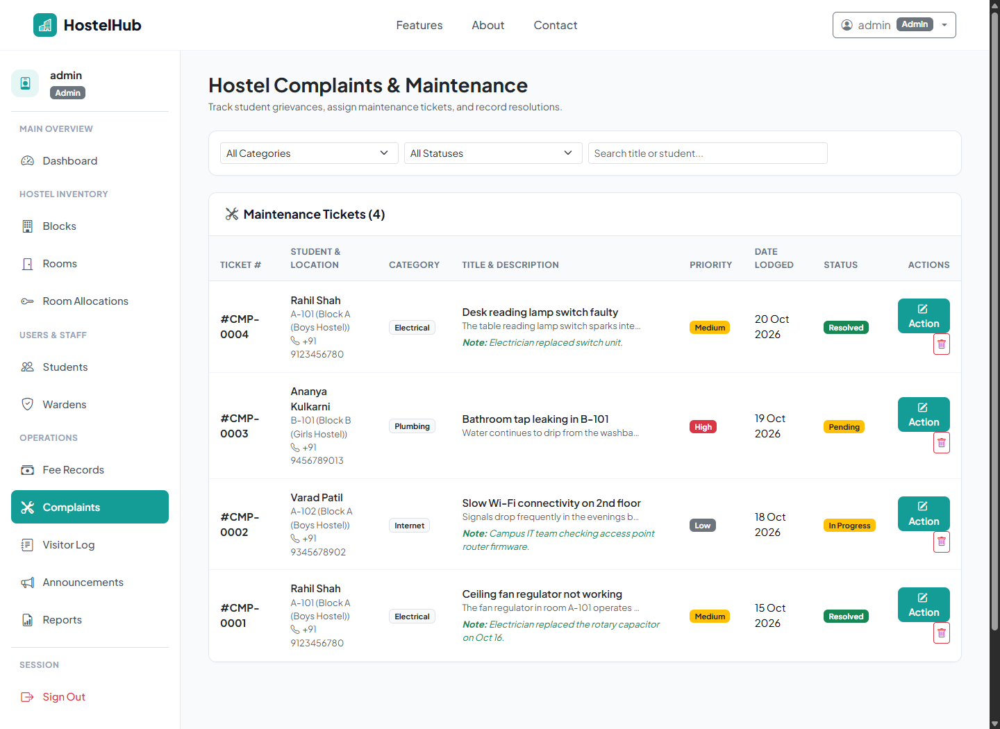
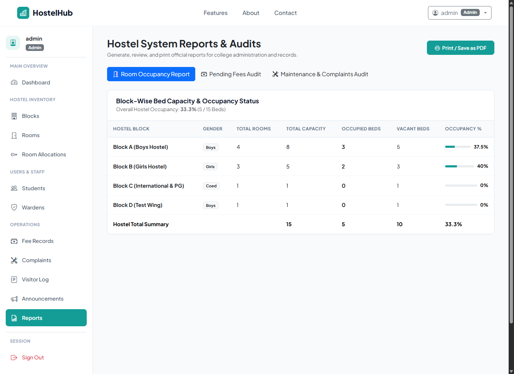
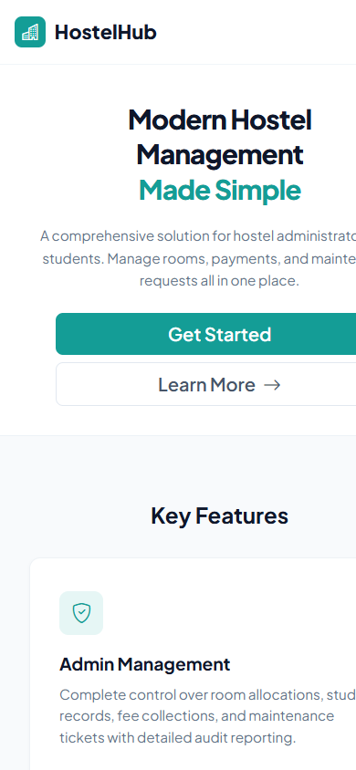

# HostelHub – College Hostel Management System

[](https://www.php.net/)
[](https://www.mysql.com/)
[](https://getbootstrap.com/)
[](LICENSE)
[](https://github.com/Rahilshah2234/hostelhub)
[](https://hostelhub.page.gd/)

> A full-stack, role-based web application engineered to digitize college hostel operations—including automated room allocation with concurrency safeguards, fee management with printable receipts, maintenance complaint workflows, visitor logging, campus announcements, and executive audit reports.

Developed by **Rahil Shah** &bull; [Live Website](https://hostelhub.page.gd/) &bull; [GitHub Repository](https://github.com/Rahilshah2234/hostelhub)

---

## 📌 Quick Links

- 🌐 **Live Application:** [https://hostelhub.page.gd/](https://hostelhub.page.gd/)
- 💻 **Source Code:** [https://github.com/Rahilshah2234/hostelhub](https://github.com/Rahilshah2234/hostelhub)
- 📖 **Documentation:** [Jump to Installation](#-local-installation-guide-xampp)

---

## 📑 Table of Contents

1. [Project Overview](#-project-overview)
2. [Key Features by Role](#-key-features-by-role)
   - [Administrator](#1-administrator)
   - [Hostel Warden](#2-hostel-warden)
   - [Student Resident](#3-student-resident)
3. [System Architecture & Security](#-system-architecture--security)
4. [Technology Stack](#-technology-stack)
5. [Project Directory Structure](#-project-directory-structure)
6. [UI Screenshots & Walkthrough](#-ui-screenshots--walkthrough)
7. [Local Installation Guide (XAMPP)](#-local-installation-guide-xampp)
8. [Database Configuration](#-database-configuration)
9. [Deployment Information](#-deployment-information)
10. [Demo Login Credentials](#-demo-login-credentials)
11. [Limitations & Future Enhancements](#-limitations--future-enhancements)
12. [Developer & Portfolio](#-developer--portfolio)

---

## 🏢 Project Overview

Traditional hostel administration often relies on manual physical registers, paper grievance slips, and disconnected spreadsheets. This workflow frequently causes room overbooking, untracked fee arrears, delayed maintenance responses, and uncoordinated security logs.

**HostelHub** addresses these challenges through a centralized web system offering:
- **Role-Based Access Control (RBAC):** Customized dashboards and strictly gated permissions for Admins, Wardens, and Students.
- **Transactional Room Allocation:** Database-level pessimistic locking (`FOR UPDATE`) to prevent race conditions and overbooking.
- **End-to-End Accounting:** Semester fee generation, online payment verification, and printable PDF/browser receipts.
- **Ticketing & Grievance Lifecycles:** Department-categorized maintenance requests with real-time status transitions.
- **Campus Safety Auditing:** Gatekeeper check-in/check-out tracking for visitors and parents.
- **Executive Reporting:** Print-ready occupancy summaries, revenue defaulter lists, and resolution analytics.

---

## ⚡ Key Features by Role

### 1. Administrator
- **Hostel Blocks & Wings:** Create and manage blocks (Boys, Girls, Co-ed) with wing designations.
- **Room & Bed Inventory:** Configure rooms with bed capacity, room types (Single, Double, Triple), tariffs, and maintenance availability.
- **Anti-Overbooking Allocations:** Allocate and reallocate rooms to students; transactional locks ensure no room exceeds capacity.
- **Fee Management:** Issue dues, mark manual or verified digital payments, and generate official stamped receipts.
- **Maintenance Oversight:** Review, triage, assign, and update status (`Pending` &rarr; `In Progress` &rarr; `Resolved`) with resolution remarks.
- **Warden Staffing:** Register wardens, map them to specific residential blocks, and manage their system credentials.
- **Visitor Auditing:** Monitor campus-wide visitor check-in, check-out, identity documentation, and host resident.
- **Broadcast Announcements:** Publish notices with high-priority sticky pins visible across all roles.
- **Executive Audit Reports:** Generate printer-friendly reports for Room Occupancy, Fee Collections & Defaulters, and Complaint Logs.

### 2. Hostel Warden
- **Block Supervision:** Real-time visibility into bed occupancy, vacancies, and maintenance statuses within their assigned block.
- **Resident Directory:** Quick directory of all students in the assigned block, including academic courses and verified emergency contact information.
- **Grievance Triage:** Resolve maintenance complaints originating specifically from their assigned block.
- **Gate Entry / Visitor Logs:** Check in and check out visitors, record relation to resident, contact numbers, and ID proofs.
- **Block Announcements:** Publish notifications and curfew advisories targeted at block residents.

### 3. Student Resident
- **Self-Service Registration:** Sign up with verified details (course, study year, emergency contacts, permanent address).
- **Resident Dashboard:** High-level overview showing allocated room, roommates, pending fees, and active grievances.
- **My Room & Roommates:** View room details, allocated bed, amenities, semester tariff, and roommate contact cards.
- **Online Fee Portal:** Review outstanding dues, submit simulated digital transaction references, and print payment receipts.
- **Maintenance Grievances:** Lodge complaints by category (*Electrical*, *Plumbing*, *Furniture*, *Wi-Fi*, *Cleanliness*) and track resolution in real time.
- **Visitor History:** Monitor personal visitor records logged at the security gate.

---

## 🔒 System Architecture & Security

HostelHub implements defensive web development practices throughout its architecture:

| Security Measure | Implementation Details |
| :--- | :--- |
| **Authentication** | Passwords hashed using industry-standard BCRYPT via PHP's `password_hash()` and `password_verify()`. |
| **Access Control (RBAC)** | Session guards (`require_login()`, `require_role()`) prevent unauthorized route traversal and privilege escalation. |
| **SQL Injection Prevention** | All database queries execute via PHP Data Objects (PDO) with parameter binding and emulation disabled (`PDO::ATTR_EMULATE_PREPARES => false`). |
| **CSRF Defense** | Form submissions require cryptographically secure anti-CSRF tokens (`csrf_token()` / `validate_csrf()`). |
| **Concurrency & Integrity** | Room allocation uses atomic PDO transactions with `SELECT ... FOR UPDATE` row locking to eliminate overbooking race conditions. |
| **Session Security** | Enforces `session.cookie_httponly = 1` and `session.use_only_cookies = 1` to mitigate cross-site scripting (XSS) session hijacking. |
| **Output Sanitization** | All user-supplied data is escaped through `htmlspecialchars()` before DOM rendering. |

---

## 🛠️ Technology Stack

| Layer | Technologies Used | Description |
| :--- | :--- | :--- |
| **Backend** | PHP 8.0+ | Native PHP with OOP structure, PDO abstractions, session middleware |
| **Database** | MySQL 5.7+ / MariaDB | Relational schema with strict foreign key constraints, indexes, and transactions |
| **Frontend** | HTML5, Vanilla CSS3, JavaScript | Modern custom `#149d96` teal design system, dynamic DOM filtering, modals |
| **UI Framework** | Bootstrap 5.3 & Bootstrap Icons | Responsive grid system, accessible form components, and icons |
| **Local Server** | Apache (via XAMPP) / PHP Built-in | Local development environments |
| **Live Hosting** | InfinityFree (Apache + PHP 8 + MySQL) | Hosted production showcase |

---

## 📁 Project Directory Structure

```text
hms/
├── admin/                      # Administrator portal modules
│   ├── allocations.php         # Room allocations & anti-overbooking engine
│   ├── announcements.php       # Campus notice broadcast management
│   ├── blocks.php              # Hostel block & wing management
│   ├── complaints.php          # Complaint triage & resolution status management
│   ├── dashboard.php           # Administrative metrics & KPI dashboard
│   ├── fees.php                # Fee collection, due dates & receipt generation
│   ├── reports.php             # Printable audit reports (Occupancy, Fees, Complaints)
│   ├── rooms.php               # Room capacity, pricing & availability
│   ├── students.php            # Student resident directory & profile editing
│   ├── visitors.php            # Campus visitor entry & exit audit log
│   └── wardens.php             # Warden registration & block assignment
├── assets/                     # Frontend static assets
│   ├── css/
│   │   └── style.css           # Custom design system (#149d96 teal accent, responsive rules)
│   └── js/
│       └── main.js             # Form validation, live table filters, receipt print triggers
├── auth/                       # Authentication & session controllers
│   ├── login.php               # Unified multi-role login with 1-click demo autofill
│   ├── logout.php              # Secure session termination & cookie clearance
│   └── register.php            # Student self-registration with profile capture
├── config/                     # Core configurations
│   ├── config.php              # Dynamic BASE_URL detection, session & app constants
│   └── database.php            # PDO connection singleton & auto-database bootstrapper
├── includes/                   # Reusable components & middleware
│   ├── auth.php                # Role verification guards & session helpers
│   ├── csrf.php                # Anti-CSRF token generator & validator
│   ├── footer.php              # Site footer with creator attribution & links
│   ├── header.php              # Responsive top navbar & metadata
│   ├── helpers.php             # Formatting helpers (currency ₹, dates, status badges)
│   └── sidebar.php             # Dynamic role-aware dashboard sidebar navigation
├── screenshots/                # Application UI preview screenshots
├── student/                    # Student resident portal modules
│   ├── complaints.php          # Submit & track maintenance grievances
│   ├── dashboard.php           # Student overview, room details & announcements
│   ├── fees.php                # View dues, submit payment & print receipts
│   ├── my_room.php             # Allocated room amenities & roommates directory
│   ├── profile.php             # Student profile & emergency contact management
│   └── visitors.php            # Personal visitor history
├── warden/                     # Hostel Warden portal modules
│   ├── announcements.php       # Block-specific circulars & curfew notices
│   ├── complaints.php          # Block complaint triage & resolution
│   ├── dashboard.php           # Supervised block overview & active visitors
│   ├── rooms.php               # Room-by-room bed occupancy inspection
│   ├── students.php            # Block resident directory with emergency contacts
│   └── visitors.php            # Gate visitor check-in/out registration
├── database.sql                # Complete relational schema & seed demo data
├── index.php                   # Public landing page with features & about section
├── receipt.php                 # Formatted printable fee payment receipt
└── README.md                   # Comprehensive project documentation
```

---

## 📸 UI Screenshots & Walkthrough

### 1. Landing Page
Modern landing page featuring the custom `#149d96` teal color scheme, hero section, key features, and project information.


### 2. Multi-Role Authentication
Unified login supporting Administrator, Warden, and Student logins with 1-click demo credential autofill.


### 3. Administrator Dashboard
Centralized metrics displaying total residents, active rooms, pending grievances, unpaid fees, and quick actions.


### 4. Warden Dashboard
Supervised block status showing real-time occupancy, active gate visitors, and unresolved block tickets.


### 5. Student Resident Portal
Personalized student overview displaying allocated room, roommates, payment status, and campus notices.


### 6. Room Allocation & Anti-Overbooking Module
Interactive bed assignment system with database-level concurrency locks preventing room overbooking.


### 7. Fee Management & Payment Portal
Semester fee records, payment status badges, and transaction reference verification.


### 8. Maintenance Complaints & Resolution Tracker
Category-based grievance tracking with status workflows (`Pending`, `In Progress`, `Resolved`) and remarks.


### 9. Official Printable Audit Reports
Audit reports for room occupancies, fee defaulters, and maintenance logs with browser print stylesheets (`@media print`).


### 10. Mobile Responsive Layout
Optimized layout with fluid containers, collapsed mobile navigation, and tailored touch targets.


---

## 🚀 Local Installation Guide (XAMPP)

Follow these steps to run HostelHub locally on your machine using XAMPP:

### Prerequisites
- **XAMPP** (with Apache and MySQL / MariaDB, running PHP 8.0 or higher)
- Web Browser (Chrome, Edge, Firefox)

### Step 1: Place the Project in XAMPP
Copy or clone the `hms` project folder into your XAMPP `htdocs` directory:
```text
C:\xampp\htdocs\hms
```

### Step 2: Start Apache and MySQL
1. Launch the **XAMPP Control Panel**.
2. Click **Start** next to **Apache**.
3. Click **Start** next to **MySQL**.

### Step 3: Setup the Database
You can set up the database using either of the following two methods:

#### Method A: Automatic Auto-Setup (Recommended)
HostelHub features an automatic database bootstrapper in `config/database.php`. When you first visit `http://localhost/hms`, the application will automatically create the `hostelhub_db` database and import `database.sql` if it does not already exist.

#### Method B: Manual Import via phpMyAdmin
1. Open your browser and navigate to:
   ```text
   http://localhost/phpmyadmin/
   ```
2. Click on **New** in the left sidebar.
3. Enter database name: `hostelhub_db` with Collation: `utf8mb4_unicode_ci`, then click **Create**.
4. Select `hostelhub_db` in the sidebar and navigate to the **Import** tab.
5. Click **Choose File**, select `database.sql` from your project folder (`C:\xampp\htdocs\hms\database.sql`), and click **Import**.

### Step 4: Access the Application
Open your browser and navigate to:
```text
http://localhost/hms
```

---

## ⚙️ Database Configuration

Database connection parameters are located in [`config/database.php`](config/database.php):

```php
// config/database.php
define('DB_HOST', 'localhost');
define('DB_PORT', '3306');
define('DB_USER', 'root');
define('DB_PASS', '');
define('DB_NAME', 'hostelhub_db');
```

### Configuration Parameters Explained:
- `DB_HOST`: Hostname of the MySQL server (`localhost` or `127.0.0.1` for local XAMPP).
- `DB_PORT`: MySQL server port (default is `3306`).
- `DB_USER`: Database username (default for XAMPP is `root`).
- `DB_PASS`: Database password (default for XAMPP is an empty string `""`).
- `DB_NAME`: Database name (set to `hostelhub_db`).

> **Note:** If deploying to a remote server (e.g. InfinityFree, cPanel, or VPS), update these constants with the database host, username, password, and database name provided by your hosting provider.

---

## 🌐 Deployment Information

### Live Production Deployment
- **Live URL:** [https://hostelhub.page.gd/](https://hostelhub.page.gd/)
- **Hosting Platform:** InfinityFree (Free Web Hosting with PHP & MySQL)
- **Architecture:** Apache web server running PHP 8.x with remote MySQL database instance.

### Development vs. Production Differences
| Setting | Local Development (XAMPP) | Production (InfinityFree / Live Host) |
| :--- | :--- | :--- |
| **URL Path** | `http://localhost/hms` or `http://127.0.0.1:8080` | `https://hostelhub.page.gd/` |
| **Database Host** | `localhost` | Remote MySQL Host (e.g. `sqlXXX.infinityfree.com`) |
| **Database User** | `root` | Host-assigned database user |
| **Database Password** | `""` (blank) | Secure host password |
| **SSL / HTTPS** | Optional | Enforced via HTTPS |

---

## 🔑 Demo Login Credentials

The database is pre-seeded with sample records for all three user roles. All demo accounts use the standard password:

```text
password123
```

| Role | Username | Password | Details / Assigned Scope |
| :--- | :--- | :--- | :--- |
| **Administrator** | `admin` | `password123` | Chief Hostel Administrator (Full System Access) |
| **Hostel Warden** | `warden_patil` | `password123` | Supervisor for Block A (Boys Hostel) |
| **Hostel Warden** | `warden_sunita` | `password123` | Supervisor for Block B (Girls Hostel) |
| **Student** | `rahil` | `password123` | **Rahil Shah** &bull; B.Tech AI & DS &bull; Room A-101 |
| **Student** | `tejas` | `password123` | Student Resident &bull; Room A-101 |
| **Student** | `varad` | `password123` | Student Resident &bull; Room A-102 |
| **Student** | `ananya` | `password123` | Student Resident &bull; Room B-101 |
| **Student** | `sneha` | `password123` | Student Resident &bull; Room B-201 |

*(Tip: On the login page, click any of the 1-click demo buttons to automatically populate credentials for testing).*

---

## 🔮 Limitations & Future Enhancements

While HostelHub provides a robust foundation for hostel administration, the following features are planned for future iterations:
- **Payment Gateway Integration:** Direct checkout integration with Razorpay, Stripe, or UPI QR dynamic generation.
- **Automated Notifications:** SMS and Email dispatch for fee payment receipts, curfew alerts, and complaint updates via PHPMailer / Twilio.
- **Photo Attachments:** Enable students to upload photos of maintenance issues when lodging complaints.
- **Digital Gate Passes:** QR-code generation for verified student night-outs and visitor entry approval.
- **Server-Side PDF Engine:** Integration with Dompdf or TCPDF for automated PDF receipt generation without relying on browser print dialogs.
- **Fine-Grained Audit Logs:** Comprehensive event stream capturing every admin override and allocation change.

---

## 👨‍💻 Developer & Portfolio

**Rahil Shah**  
Lead Full-Stack Developer & System Architect  

- 🌐 **Live Demo:** [https://hostelhub.page.gd/](https://hostelhub.page.gd/)  
- 🐙 **GitHub Repository:** [https://github.com/Rahilshah2234/hostelhub](https://github.com/Rahilshah2234/hostelhub)  
- 📂 **Portfolio Project:** HostelHub – College Hostel Management System  

---

## 📄 License

This project is open-source and available under the [MIT License](LICENSE).